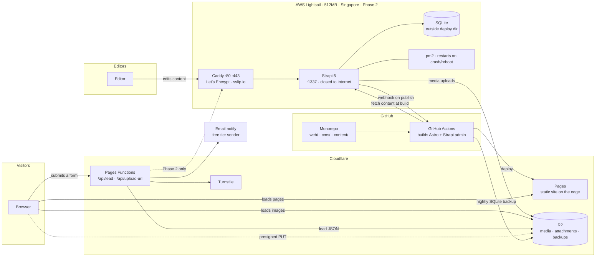
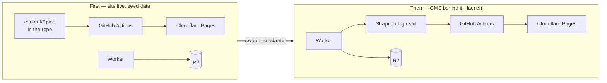
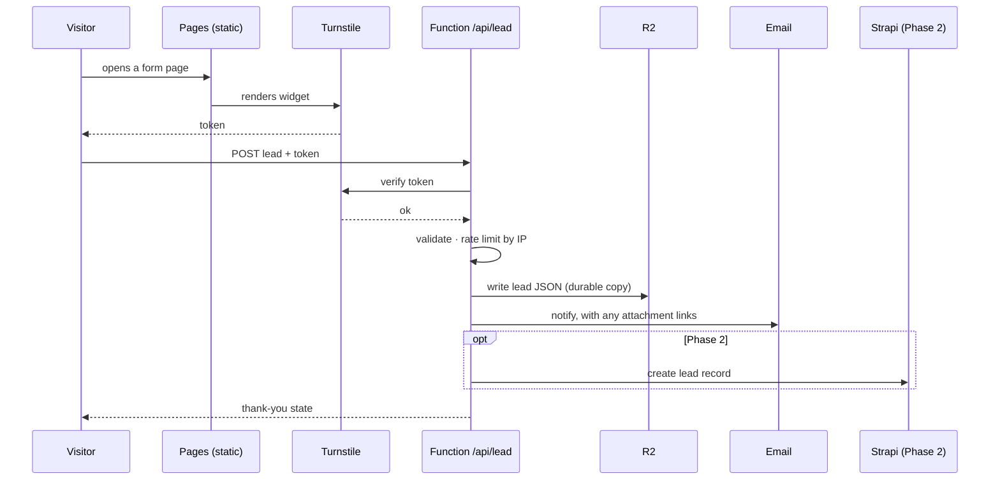
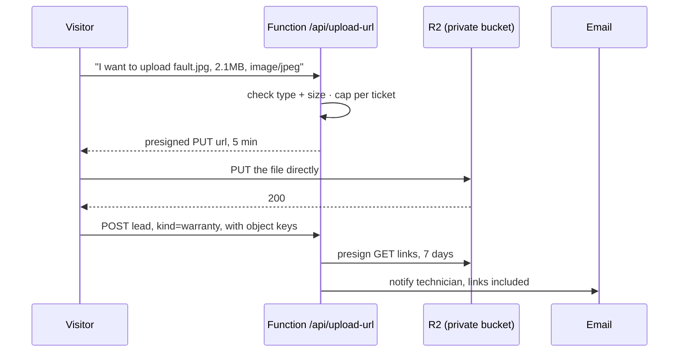
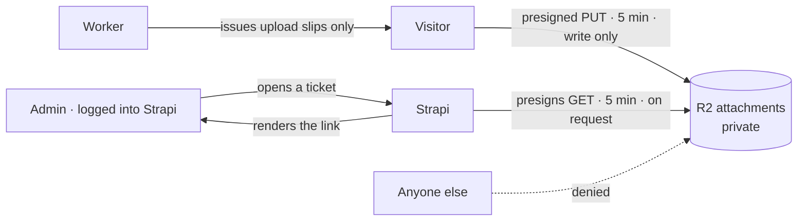
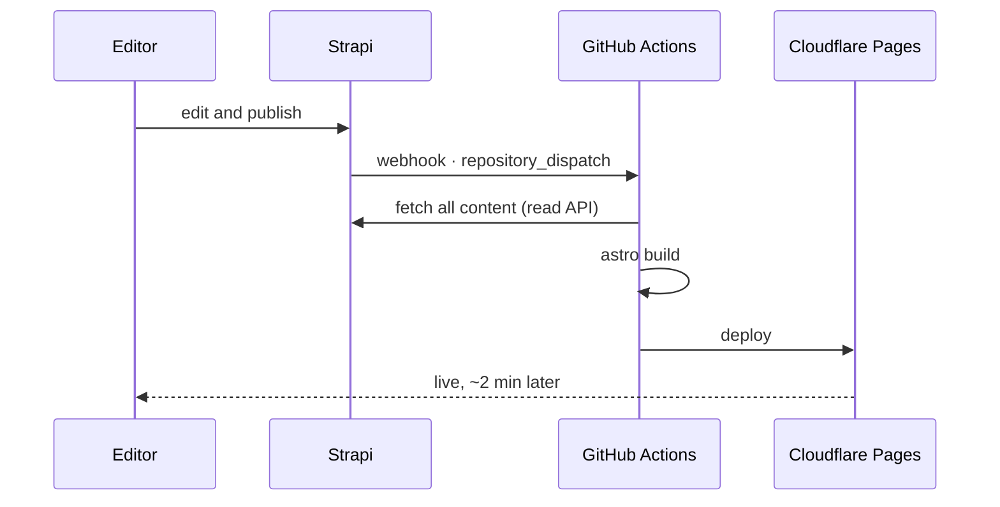
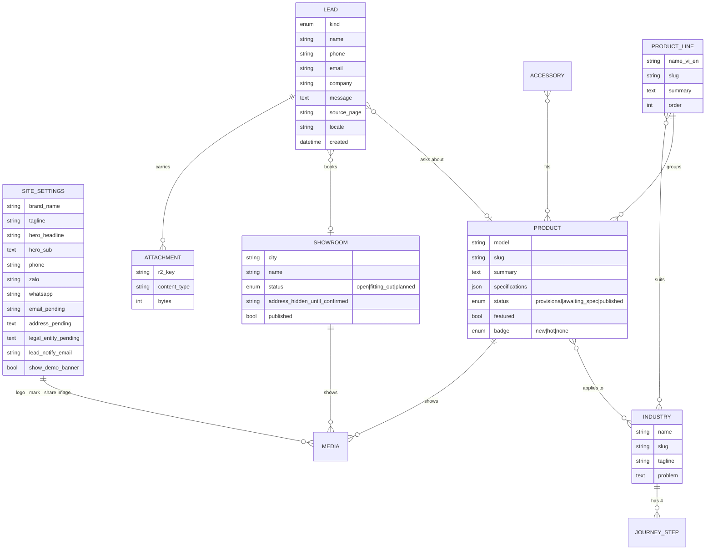
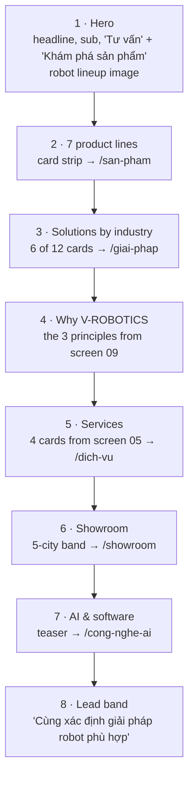

# V-ROBOTICS — architecture

Written 2026-11-07, alongside [plan.md](plan.md). Diagrams are Mermaid; VS Code's markdown preview
and GitHub both render them.

The 13 reference screens this is drawn from stay out of the repo, in `notes.local/` on Hau's
machine, because they are the client's material. This file is the committed record of what was
read from them.

---

## The one idea worth holding

**Visitors never reach the server.** Everything a visitor loads is a static file on Cloudflare's
edge. The server exists so that *editors* can change content, and its output is a build, not a
request. Only two things happen at run time — sending a lead, and uploading a photo to a support
ticket — and both are handled by small Cloudflare Functions that never touch Lightsail.

That split is what keeps a 512 MB box viable, keeps the bill near nothing, and means that if the
server falls over at 3am the public site doesn't notice.

Two kinds of time, then, and most confusion about this system comes from mixing them up:

| | Build time | Run time |
|---|---|---|
| **Who triggers it** | An editor publishing, or a push | A visitor submitting a form |
| **What runs** | GitHub Actions, Astro, Strapi's read API | A Cloudflare Function |
| **How often** | A few times a day | A few times a day |
| **If it breaks** | Content goes stale, site stays up | Leads stop; site stays up |

---

## The whole system



Read it as three loops that barely touch each other:

- **The content loop** (editor → Strapi → webhook → Actions → Pages). Slow, occasional, and entirely
  invisible to visitors.
- **The visitor loop** (browser → Pages + R2). Pure static delivery. No server, no database.
- **The lead loop** (browser → Function → R2 + email, and in Phase 2 also → Strapi). The only
  writing path from the public internet, and it goes through one door we control.

---

## The order it gets stood up

Everything above is in the MVP — the client edits content at launch, so Strapi is launch-blocking,
not a later phase. What survives from the earlier two-phase plan is the **order**, because building
pages against a live CMS is slower than building them against a file, and because a site that's
already live is a site you can judge.



The thing that makes the swap cheap is the **content adapter**: the Astro site asks one module for
"all products", "this industry", "the showrooms". At first that module reads JSON from the repo;
later it reads Strapi's API. The 15 page templates never change. Swapping is one file, not a
rewrite — which is exactly why the content shape gets settled in P1, before any page is built.

**What changes now that Strapi is launch-blocking:** its riskiest assumption has to be tested first.
If Strapi won't run usably on 512 MB, that's a hosting decision affecting everything downstream, and
it is far cheaper to learn in the first hour than the sixth. Hence the spike at the top of the
plan — stand the box up, run Strapi, open the admin, measure. One answer, before anything depends
on it.

---

## Sending a lead

All five forms — contact, showroom booking, service request, partnership proposal, warranty ticket —
walk this same path. One record, one door, one spam defence.



Why this and not the brief's "post straight to Strapi": that version lets the open internet write to
the database and puts the server's address in the page source. Here the server stays unlisted, spam
is stopped at the edge before it costs anything, and in Phase 1 the whole thing works with no server
at all. Leads land in two places on purpose — email gets read, R2 doesn't get lost.

**Lead kinds** carried by one record:

| kind | Extra fields it fills | From screen |
|---|---|---|
| `contact` | need group | 13 |
| `consult` | product of interest | 02, any "Tư vấn" |
| `showroom_booking` | city, robot line, preferred date | 07, 11 |
| `service` | service type (rent / finance / deploy) | 05 |
| `partnership` | partner type | 08 |
| `warranty` | robot serial, fault description, attachments | 12 |
| `ai_assist` | industry, need, stage | 10 |

---

## Uploading a photo to a support ticket

Your call on R2 — and it's the right one, because it means the warranty ticket ships in the MVP
instead of waiting for a server to have somewhere to put files.

The browser uploads **straight to R2**, not through the Function. The Function only hands out a
short-lived permission slip.



Three reasons this shape and not an upload proxy: the file never passes through a Worker, so there's
no request-size ceiling and no CPU time burned on bytes; the bucket stays private, so attachments
aren't guessable URLs on the open web; and the whole path stands up before Lightsail does.

### Worker, not Lambda

A Cloudflare Worker, and it's not close. R2 and Pages are already Cloudflare, so the Worker sits
beside the bucket with a native binding and no cross-cloud credentials; a Lambda would mean a second
provider, a second deploy, an AWS key pair held somewhere, and a cold start between a visitor and
their upload. The only argument for Lambda would be if the rest of the stack were AWS, and it isn't
— Lightsail only serves the admin panel.

It deploys as a **Pages Function**, which *is* a Worker, just one that ships with the site's build
rather than on its own. Same runtime, one deploy, one place to set secrets.

### The two endpoints, and what they promise

```
POST /api/upload-url          public · Turnstile-gated
  in   { filename, contentType, bytes, turnstileToken }
  checks  token valid · type in allow-list · bytes <= 10MB
          <= 5 objects per ticket · per-IP rate limit
  out  { putUrl, key }        putUrl expires in 5 minutes
                              key = tickets/<random>/<random>.<ext>

POST /api/lead                public · Turnstile-gated
  in   { kind, name, phone, ..., attachmentKeys[] }
  checks  token valid · required fields by kind
          every key matches one this IP was just issued
  out  { ok }
```

Secrets live in Pages' encrypted environment: an R2 access key scoped to **one** bucket, and the
Turnstile secret. The attachments bucket is separate from the public media bucket, so a leak of one
credential isn't a leak of both.

### "Only admin can load, right?"

Close, and worth being exact about, because the honest answer has a wrinkle and a fix.

**The bucket is private.** There is no public URL, no bucket listing, and keys are random on two
levels, so nothing is guessable or enumerable. That part holds absolutely.

**But a presigned link is a bearer token, not an identity check.** Anyone holding the URL can fetch
the object until it expires — no login involved. So the question isn't really "is the bucket
private" but "who ends up holding links". My earlier sketch emailed technicians a seven-day link,
which means a forwarded email is a working link for a week. That is weaker than "only admin".

**Because the client now edits at launch, we can do it properly.** Strapi is there, with real
accounts and roles, so:



- **The Worker never presigns a download.** It only ever hands out upload slips. There is no public
  endpoint that returns a readable URL, so there's nothing to attack.
- **Downloads are presigned by Strapi**, server-side, only for a request that already carries a
  valid admin session with the right role, and only for the one attachment being viewed.
- **Expiry drops from seven days to five minutes**, because an admin asks for it at the moment they
  look rather than receiving it in advance. A leaked link is dead long before it travels.
- **Notification emails carry no links** — just "ticket #123 has 2 attachments, open the admin".

So: only a logged-in admin can *obtain* a link, and the link is useless within minutes. That's as
close to "only admin can load" as object storage gets without proxying every byte through a server,
which on a 512 MB box is exactly what we don't want to do.

The public side is write-only and deliberately so — a visitor must be able to attach a photo without
an account. What stops that being abused is the Turnstile gate, the type and size caps, the per-IP
rate limit, and the fact that an uploaded object is unreachable to its own uploader the moment the
five-minute PUT slip expires.

One residual to accept: the bucket can collect junk from anyone who passes Turnstile. A lifecycle
rule deleting objects not attached to a lead within 24 hours handles it, and goes in at P3b.

---

## Publishing content



Two rules this picture enforces. **Nothing is ever built on the instance** — Actions builds both the
site and Strapi's admin panel, and the box only serves what it is handed. Strapi's admin is a
front-end build and the hungriest thing that would ever run on 512 MB; this is the specific trap
the brief's "never build on the instance" line is protecting against. And **media goes to R2, not
the instance disk** — a change from the brief, below.

---

## The content model

The line between CMS and code is **facts the client owns** versus **prose that rarely moves**:

| In the CMS | In the code |
|---|---|
| Products, lines, industries, showrooms, accessories | The four service descriptions (screen 05) |
| **Brand: name, logo, mark, tagline, share image, favicon** | The six partner types (screen 08) |
| **Contact: phone, Zalo/WhatsApp, email, address, legal entity** | About's three principles (screen 09) |
| **The demo banner toggle** | The six AI capability cards (screen 06) |

Brand and contact move to the CMS on your call, and the screens themselves argue for it — screen 13
says outright that email, address and legal entity are *"bổ sung sau khi xác minh"*, which is a
field waiting to be filled, not a constant. Same for the phone number, which appears on the contact
page and in the footer of every page.

It costs a single type and about twenty minutes, so it folds into P1 and P2a rather than becoming a
piece. **"Etc" is doing some work in your message** — the list below is what I've put in. If
something you'd want to change without calling me isn't there, say so now while it's free.



Four notes on shape. `status` on **product** is what lets the catalog ship honestly with the
designer's "TÊN MODEL TẠM" and "CHỜ HỒ SƠ KỸ THUẬT" badges rather than pretending. `status` and
`published` on **showroom** reflect screen 07's own caveat — addresses and hours aren't shown until
the project owner confirms them. **lead** is read-only to the public role: the Worker creates them,
nobody on the internet can list them.

And **site_settings** is a single type with a rule attached: every field in it is allowed to be
empty, and the site renders correctly when it is. The `_pending` fields are the ones screen 13 says
are still being verified — an empty address hides the address block rather than printing a blank
label. That rule is what makes brand genuinely "uploadable later": the site ships with placeholder
brand, the client replaces it whenever they're ready, and nothing has to be rebuilt by hand. The
logo is fetched and optimized at build time rather than hotlinked, so it stays fast in the nav of
every page, and `show_demo_banner` lets the client switch off the "BẢN MẪU THIẾT KẾ" band
themselves at launch.

---

## Is the skeleton strong enough to customise later?

Mostly yes, and it's worth being precise about where that holds and where it doesn't — because the
answer is what lets us stop guessing at requirements nobody has yet.

**Cheap to change later — don't spend thought on these now:**

| Change | Cost |
|---|---|
| Add a field to any type | Minutes |
| Move a page's prose from code into the CMS | An afternoon |
| Add a page, a section, a band on the homepage | Under an hour |
| Change any copy, image, logo, phone number | An upload, by the client |
| Add a product attribute, a badge, a filter | Under an hour |

This is the whole reason the brand decision was easy to absorb: adding fields is near-free, so an
unknown field is not a risk, it's a Tuesday.

**Expensive to change later — these are the ones worth getting right now:**

| Change | Why it hurts |
|---|---|
| **Relationships between types** | Reshaping product↔industry or collapsing line into product means migrating real content *and* rewriting templates that read it. The one genuinely costly class of change. |
| **Which fields are localized** | Strapi sets localization per field. Turning it on later for a field that already has data is a migration, not a toggle. |
| **Slugs, once Google has indexed them** | Free to change today, a redirect map later. No SEO yet, so this one is still free. |
| **The 512 MB hosting call** | Which is exactly why it's a spike at the front rather than a discovery at the end. |

Two of those four are already handled: the relationships are modelled from all 13 screens rather
than guessed, and the hosting call gets tested first. For localization I'm taking the safe side —
**every customer-facing text field is localized from the start**, even though only Vietnamese gets
filled at MVP. Turning localization on for a field costs nothing while it's empty and is a migration
once it isn't, so there's no reason to be clever about it.

So: build the skeleton, ship it, and let the client's actual requests drive the rest. A field they
ask for next month is cheap. A relationship we got wrong is not — and that's the part we've done
carefully.

## The homepage

There's no home screen in the 13 references and no "Trang chủ" in the nav, so this is built from the
design language of the rest rather than copied from a reference. Every band below reuses a component
built for another page, which is why it costs roughly half an hour rather than a piece of its own.



It's a B2B catalog site, so the homepage has one job: get a visitor into the catalog or into a form
within one click. Hence products second and a lead band last.

---

## Routes

14 pages, plus the homepage. All Vietnamese at MVP; the `/en/` prefix is wired but unfilled, and the
switcher stays hidden until it is.

| Route | Source | Screen |
|---|---|---|
| `/` | code + CMS teasers | — new |
| `/san-pham` | CMS | 01 |
| `/san-pham/[slug]` | CMS | 02 |
| `/giai-phap` | CMS | 03 |
| `/giai-phap/[slug]` | CMS | 04 |
| `/dich-vu` | code | 05 |
| `/dich-vu/bao-hanh` | code + form | 12 |
| `/cong-nghe-ai` | code | 06 |
| `/showroom` | CMS | 07 |
| `/showroom/dat-lich` | code + form | 11 |
| `/hop-tac` | code + form | 08 |
| `/ve-chung-toi` | code | 09 |
| `/tro-ly-ai` | code + form | 10 |
| `/lien-he` | code + form | 13 |
| `/api/lead`, `/api/upload-url` | Functions | — |

---

## Three changes from the brief

**1. Media goes to R2, not the instance disk.** The brief stores Strapi uploads on the Lightsail
disk and copies them to R2 nightly. Pointing Strapi's upload provider at R2 directly is better on
every axis: images serve from Cloudflare with no egress charge instead of from a 512 MB box in
Singapore, the 20 GB disk stops being a ceiling, and the nightly uploads backup disappears because
the uploads already live in the backup's destination. Only SQLite then needs backing up.

**2. Leads go through a Function, not straight to Strapi.** Reasoning in "Sending a lead" above.

**3. Uploads are in the MVP, direct to R2.** Reversing my own earlier cut, on your call. Downloads
are not a Worker endpoint at all — Strapi presigns them behind its own login. See
"Only admin can load, right?" above.

---

## What this costs

| | At launch |
|---|---|
| Cloudflare Pages | Free |
| Pages Functions (the Worker) | Free tier, 100k req/day |
| R2 | Free to 10 GB, no egress charge |
| Turnstile | Free |
| Email notify | Free tier |
| GitHub Actions | Free on a private repo's allowance |
| Lightsail 512 MB | ~$5/mo |
| **Total** | **~$5/mo** |

Figures from the brief and general knowledge — the Lightsail price and the free-tier limits get
checked against current documentation at the spike, before anything depends on them. If the spike
says 512 MB won't carry an admin the client can actually work in, the 1 GB plan is the answer and
the total roughly doubles. Still small, but it's your call, so it comes to you as a question rather
than a decision.

---

## The risks this drawing makes visible

**Strapi on 512 MB — now launch-blocking.** It was always the main technical risk; the client
editing at launch means it can also hold up the launch, which is why it moves to a spike at the very
front. The architecture still contains the damage: visitors never touch the server, so if it dies
the site keeps serving and only editing stops. But "the admin panel is usable enough that a client
will actually use it" is a bar the brief's 512 MB plan has not yet cleared, and we should find out
before building on it. Worst case is the 1 GB plan — a few dollars, not a redesign.

**R2 credentials in the Worker.** An access key lives in Pages' encrypted environment, scoped to the
attachments bucket alone and write-only in practice, since the Worker never presigns a read. Keep
the attachments bucket separate from the public media bucket so a leak of one isn't a leak of both.

**The public can write to the attachments bucket.** By design — a visitor attaches a photo without
an account. Turnstile, the type and size caps, the per-IP limit and a 24-hour lifecycle rule on
unattached objects are what keep that from becoming free storage for strangers.

**The build becomes the single point of failure for content.** If Actions breaks, content freezes —
the site stays up, but stale. Acceptable, and worth knowing.

**Nothing here is a test.** Per your call to skip them, the first check of each piece is you looking
at the live URL.
