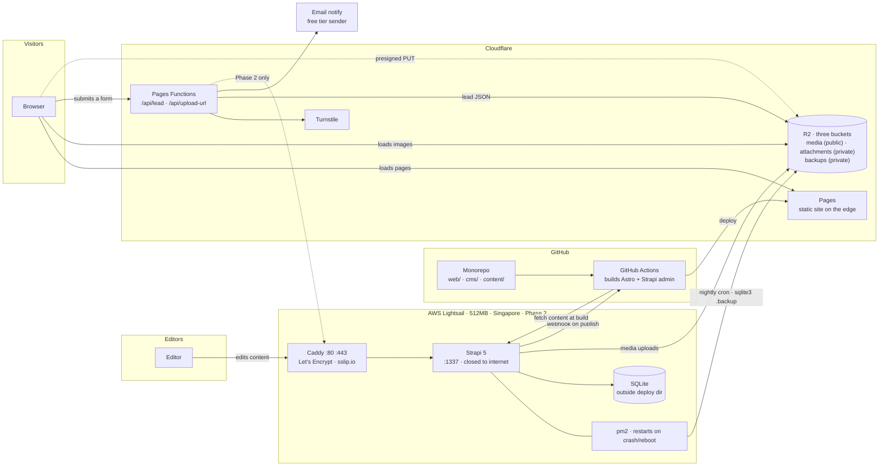
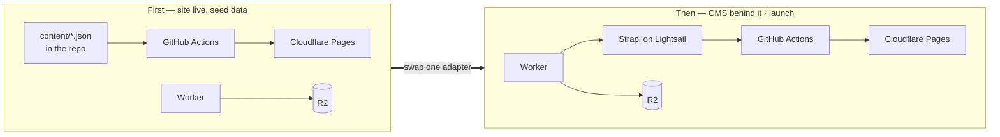
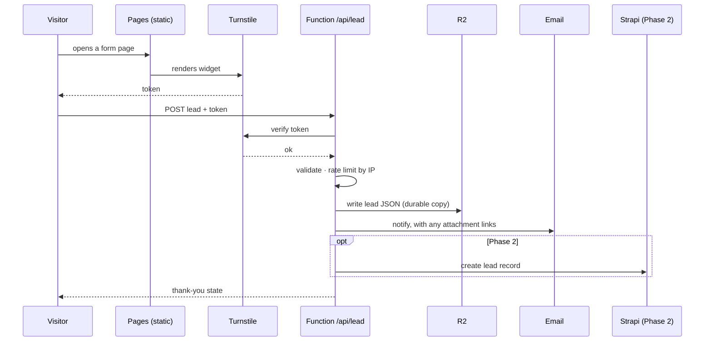
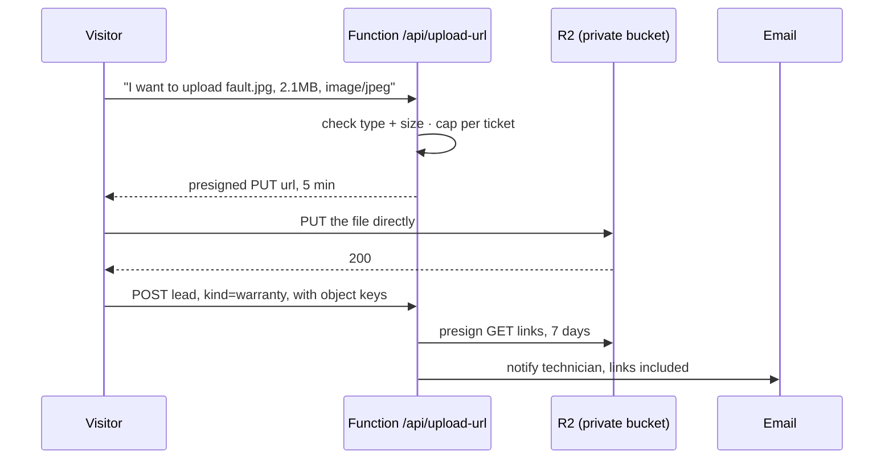
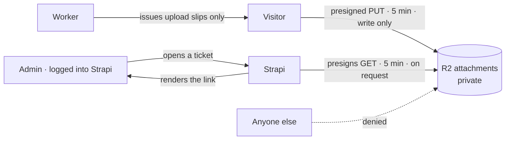
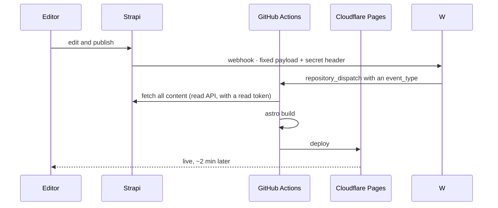
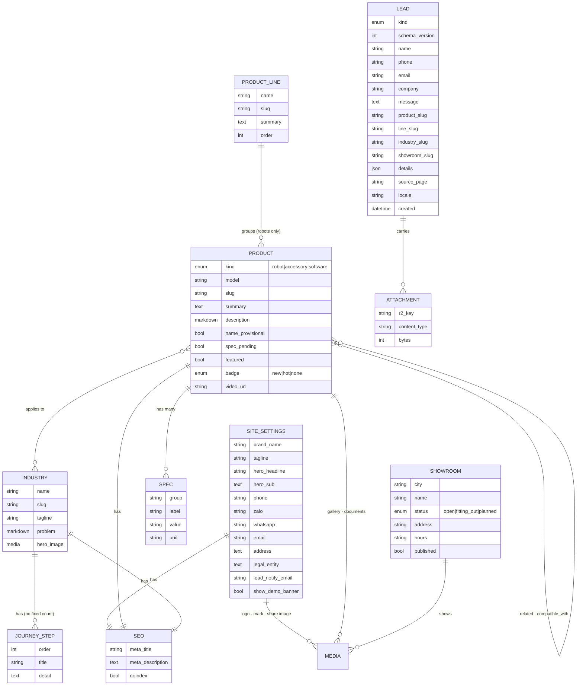
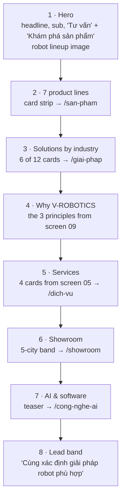

# V-ROBOTICS — architecture

Written 2026-11-07, alongside [plan.md](plan.md). Diagrams are Mermaid; VS Code's markdown preview
and GitHub both render them.

The 13 reference screens this is drawn from stay out of the repo, in `notes.local/` on Hau's
machine, because they are the client's material. This file is the committed record of what was
read from them.

---

## The one idea worth holding

**Visitors never reach the server.** Everything a visitor loads is a static file on Cloudflare's
edge. The server exists so that *editors* can change content, and its output is a build, not a
request. Only two things happen at run time — sending a lead, and uploading a photo to a support
ticket — and both are handled by small Cloudflare Functions that never touch Lightsail.

That split is what keeps a 512 MB box viable, keeps the bill near nothing, and means that if the
server falls over at 3am the public site doesn't notice.

Two kinds of time, then, and most confusion about this system comes from mixing them up:

| | Build time | Run time |
|---|---|---|
| **Who triggers it** | An editor publishing, or a push | A visitor submitting a form |
| **What runs** | GitHub Actions, Astro, Strapi's read API | A Cloudflare Function |
| **How often** | A few times a day | A few times a day |
| **If it breaks** | Content goes stale, site stays up | Leads stop; site stays up |

---

## The whole system



Read it as three loops that barely touch each other:

- **The content loop** (editor → Strapi → webhook → Actions → Pages). Slow, occasional, and entirely
  invisible to visitors.
- **The visitor loop** (browser → Pages + R2). Pure static delivery. No server, no database.
- **The lead loop** (browser → Function → R2 + email, and in Phase 2 also → Strapi). The only
  writing path from the public internet, and it goes through one door we control.

---

## The order it gets stood up

Everything above is in the MVP — the client edits content at launch, so Strapi is launch-blocking,
not a later phase. What survives from the earlier two-phase plan is the **order**, because building
pages against a live CMS is slower than building them against a file, and because a site that's
already live is a site you can judge.



The thing that makes the swap cheap is the **content adapter**: the Astro site asks one module for
"all products", "this industry", "the showrooms". At first that module reads JSON from the repo;
later it reads Strapi's API. The 15 page templates never change. Swapping is one file, not a
rewrite — which is exactly why the content shape gets settled in P1, before any page is built.

**What changes now that Strapi is launch-blocking:** its riskiest assumption has to be tested first.
If Strapi won't run usably on 512 MB, that's a hosting decision affecting everything downstream, and
it is far cheaper to learn in the first hour than the sixth. Hence the spike at the top of the
plan — stand the box up, run Strapi, open the admin, measure. One answer, before anything depends
on it.

---

## Sending a lead

All five forms — contact, showroom booking, service request, partnership proposal, warranty ticket —
walk this same path. One record, one door, one spam defence.



**Two things this flow needs that an earlier draft left as gestures.**

*"Email notify, free tier sender" is not a provider.* A Worker cannot speak SMTP; it needs an HTTP
email API. And most of them — Resend among them — will only send to the account owner's own address
until a sending domain is verified, which this plan has no custom domain for. So the MVP uses a
provider that verifies a **single sender address** instead of a domain (Brevo and similar do this),
named with its from-address and its API key in Pages' secrets. When the custom domain arrives, the
provider choice can be revisited.

*The Worker cannot read `lead_notify_email` from Strapi.* That field was put in `site_settings` on
the reasoning that the client should own it — which is right — but the Function runs at request
time and never calls Strapi, by design. So the build carries it across: the Astro build writes the
handful of runtime-needed settings to `dist/_site/settings.json`, and the Function reads that with
the assets binding, falling back to a Pages environment variable when the file is absent. The client
still edits the address in Strapi; it reaches the Worker at the next build, which a publish triggers
anyway.

Why a Function at all, and not the brief's "post straight to Strapi": that version lets the open
internet write to the database and puts the server's address in the page source. Here the server stays unlisted, spam
is stopped at the edge before it costs anything, and in Phase 1 the whole thing works with no server
at all. Leads land in two places on purpose — email gets read, R2 doesn't get lost.

**Lead kinds** carried by one record:

| kind | Extra fields it fills | From screen |
|---|---|---|
| `contact` | need group | 13 |
| `consult` | product of interest | 02, any "Tư vấn" |
| `showroom_booking` | city, robot line, preferred date | 07, 11 |
| `service` | service type (rent / finance / deploy) | 05 |
| `partnership` | partner type | 08 |
| `warranty` | robot serial, fault description, attachments | 12 |
| `ai_assist` | industry, need, stage | 10 |

---

## Uploading a photo to a support ticket

Your call on R2 — and it's the right one, because it means the warranty ticket ships in the MVP
instead of waiting for a server to have somewhere to put files.

The browser uploads **straight to R2**, not through the Function. The Function only hands out a
short-lived permission slip.



Three reasons this shape and not an upload proxy: the file never passes through a Worker, so there's
no request-size ceiling and no CPU time burned on bytes; the bucket stays private, so attachments
aren't guessable URLs on the open web; and the whole path stands up before Lightsail does.

### Worker, not Lambda

A Cloudflare Worker, for proximity and one deploy: it ships with the site's build, shares its
secrets, and sits in the same network as the bucket. A Lambda would mean a second provider, a second
deploy and a cold start between a visitor and their upload, for nothing gained — the rest of the
stack isn't AWS; Lightsail only serves the admin panel.

**Not** because a native binding avoids credentials. That was wrong in an earlier draft, and it
matters because it changes what gets built: **R2's native binding cannot produce a presigned URL.**
Presigning needs R2's S3-compatible API — an access key and secret scoped to the attachments bucket,
held in Pages' encrypted environment, with a small signing library (`aws4fetch`) in the Function.
The binding is still used, for what it can do: `head()` to inspect an object, `get`/`put` to move
one.

It deploys as a **Pages Function**, which *is* a Worker, just one that ships with the site's build
rather than on its own. Same runtime, one deploy, one place to set secrets.

### CORS, which nothing works without

A browser `PUT` to a presigned R2 URL fails at preflight until the bucket carries a CORS rule. This
is the first thing P3b meets, so it is written down rather than discovered:

```
AllowedOrigins: the production pages.dev origin, plus preview subdomains
AllowedMethods: PUT
AllowedHeaders: Content-Type
MaxAgeSeconds:  3600
```

The signature must cover `Content-Type`, or the browser's `PUT` is rejected for a signature
mismatch.

### The three endpoints, and what they promise

```
POST /api/upload-url          public · Turnstile-gated
  in   { filename, contentType, bytes, turnstileToken }
  checks  token valid · type in allow-list · claimed bytes <= 10MB
  out  { putUrl, key, sig }   putUrl expires in 5 minutes
                              key = pending/<random>/<random>.<ext>
                              sig = HMAC over key+expiry, so /api/lead can
                                    trust a key without stored state

POST /api/lead                public · Turnstile-gated
  in   { kind, name, phone, ..., attachments[{key, sig}] }
  checks  token valid · required fields by kind · each sig valid
          env.ATTACHMENTS.head(key) for REAL size and type;
            over-size or wrong-type objects are deleted and rejected
  does    copies accepted objects  pending/…  ->  tickets/<lead>/…
  out  { ok }

POST /api/rebuild             Strapi's webhook target · shared-secret header
  checks  header matches REBUILD_SECRET
  does    calls GitHub repository_dispatch with an event_type
  out  { ok }
```

Three corrections from an earlier draft are folded in above, each of which would otherwise have been
found the hard way:

- **The 10 MB cap was theatre.** It was checked when the slip was issued, but a presigned URL
  carries no size limit of its own, so a 2 GB body with a valid slip succeeds. The honest check is
  `head()` afterwards.
- **"Every key matches one this IP was just issued" needed state**, and Pages Functions have none.
  The HMAC `sig` replaces it: the Function verifies its own earlier signature and remembers nothing.
- **The per-IP rate limit is dropped.** It needed state too, and `*.pages.dev` has no WAF rules to
  lean on. Turnstile plus the type and size caps carry the load; if abuse appears, a KV namespace is
  the cheap way back.

Secrets in Pages' encrypted environment: the R2 S3 access key and secret scoped to the attachments
bucket, the Turnstile secret, `REBUILD_SECRET`, a fine-grained GitHub token for the dispatch, and
the email provider's key. The attachments bucket stays separate from the public media bucket, so a
leak of one credential isn't a leak of both.

### Turnstile tokens are single-use

A warranty ticket with three photos is four gated calls, and one widget token works once. So verify
once at the first `/api/upload-url` call and return a short-lived signed session the later calls
present, rather than resetting the widget in front of the visitor three times. The pages.dev
hostname and its preview subdomains go on the widget's allowed list.

### "Only admin can load, right?"

Close, and worth being exact about, because the honest answer has a wrinkle and a fix.

**The bucket is private.** There is no public URL, no bucket listing, and keys are random on two
levels, so nothing is guessable or enumerable. That part holds absolutely.

**But a presigned link is a bearer token, not an identity check.** Anyone holding the URL can fetch
the object until it expires — no login involved. So the question isn't really "is the bucket
private" but "who ends up holding links". My earlier sketch emailed technicians a seven-day link,
which means a forwarded email is a working link for a week. That is weaker than "only admin".

**Because the client now edits at launch, we can do it properly.** Strapi is there, with real
accounts and roles, so:



- **The Worker never presigns a download.** It only ever hands out upload slips. There is no public
  endpoint that returns a readable URL, so there's nothing to attack.
- **Downloads are presigned by Strapi**, server-side, only for a request that already carries a
  valid admin session with the right role, and only for the one attachment being viewed.
- **Expiry drops from seven days to five minutes**, because an admin asks for it at the moment they
  look rather than receiving it in advance. A leaked link is dead long before it travels.
- **Notification emails carry no links** — just "ticket #123 has 2 attachments, open the admin".

So: only a logged-in admin can *obtain* a link, and the link is useless within minutes. That's as
close to "only admin can load" as object storage gets without proxying every byte through a server,
which on a 512 MB box is exactly what we don't want to do.

**What this costs, which an earlier draft committed to without budgeting.** "Strapi presigns and
renders the link" is not a setting. It is a custom admin-authenticated route that signs a GET
against the attachments bucket, plus an admin-panel customisation so a lead's attachments appear as
links in the Content Manager — React, built in CI like the rest of the admin. Roughly an hour, and
it appeared in no piece. It is now **P7b**, after P6.

That leaves a real gap worth stating rather than hiding: between P4 (site live) and P7b, the Worker
never presigns a read, emails carry no links, and Strapi doesn't exist until P6 — so a ticket photo
is readable only in the Cloudflare dashboard. That window falls entirely inside pre-launch, when the
only tickets are our own tests, which is why keeping the strict design costs little in practice. The
alternative, emailing a 24-hour link for the MVP, is exactly the bearer-token weakness this section
exists to remove.

The public side is write-only and deliberately so — a visitor must be able to attach a photo without
an account. What stops that being abused is the Turnstile gate, the type and size caps, the per-IP
rate limit, and the fact that an uploaded object is unreachable to its own uploader the moment the
five-minute PUT slip expires.

One residual to accept: the bucket can collect junk from anyone who passes Turnstile. The fix is the
`pending/` prefix in the endpoint contract above — **not**, as an earlier draft had it, "a lifecycle
rule deleting objects not attached to a lead", which R2 cannot express. Lifecycle rules work on
prefix and age only, so the rule has to be something a prefix can say:

- uploads land under `pending/`, which expires after 1 day;
- `/api/lead` copies accepted objects to `tickets/<lead>/`, which never expires.

Written the other way round, either every attachment dies after a day or the junk never does.

---

## Publishing content



**Why the Worker is in the middle, and not a straight webhook.** An earlier draft had Strapi call
GitHub directly. That returns 422 and nothing ever rebuilds: GitHub's `repository_dispatch` requires
an `event_type` in the body, and Strapi's webhook payload is fixed at `{event, createdAt, model,
entry}` — only headers can be customised. So `/api/rebuild` takes Strapi's call, checks a shared
secret in a header, and makes the dispatch GitHub will accept. The GitHub token lives in Pages, not
on the box.

**And a concurrency group on the build**, or publishing goes badly wrong: one save in the admin
fires `entry.update` then `entry.publish`, so publishing ten products fires twenty webhooks and,
without `concurrency: { group: site-build, cancel-in-progress: true }`, twenty builds. The webhook
is subscribed to `entry.publish`, `entry.unpublish`, `entry.delete` and the media events.

**The build must fail loudly if Strapi is unreachable.** Otherwise a box that is down deploys an
empty catalog over a good one — the opposite of the "content goes stale, site stays up" property
this design is for.

Two rules this picture enforces. **Nothing is ever built on the instance** — Actions builds both the
site and Strapi's admin panel, and the box only serves what it is handed. Strapi's admin is a
front-end build and the hungriest thing that would ever run on 512 MB; this is the specific trap
the brief's "never build on the instance" line is protecting against. And **media goes to R2, not
the instance disk** — a change from the brief, below.

---

## The content model

The line between CMS and code is **facts the client owns** versus **prose that rarely moves**:

| In the CMS | In the code |
|---|---|
| Products, lines, industries, showrooms, accessories | The four service descriptions (screen 05) |
| **Brand: name, logo, mark, tagline, share image, favicon** | The six partner types (screen 08) |
| **Contact: phone, Zalo/WhatsApp, email, address, legal entity** | About's three principles (screen 09) |
| **The demo banner toggle** | The six AI capability cards (screen 06) |

Brand and contact move to the CMS on your call, and the screens themselves argue for it — screen 13
says outright that email, address and legal entity are *"bổ sung sau khi xác minh"*, which is a
field waiting to be filled, not a constant. Same for the phone number, which appears on the contact
page and in the footer of every page.

It costs a single type and about twenty minutes, so it folds into P1 and P2a rather than becoming a
piece. **"Etc" is doing some work in your message** — the list below is what I've put in. If
something you'd want to change without calling me isn't there, say so now while it's free.



Six notes on shape, four of them corrections to an earlier draft that was drawn from the *list* of
pages rather than from each page.

**One `product` collection with a `kind`, not three collections.** Screen 01's sidebar runs the
seven robot lines, then "Phụ kiện", then "Phần mềm / kho Agent", under one heading with one search
box and one card grid — and its own subtitle says "7 dòng robot • 35 model • Phụ kiện • Phần mềm /
Agent". An earlier draft had a separate `accessory` type and no software type at all, which would
have meant three card templates, three detail templates and three search indexes. One collection
means a new catalog kind is a new enum value. `line` is required for robots only, which Strapi
cannot enforce natively — validate it in the seed and accept a soft rule in the admin.

**Two booleans, not one status enum.** Screen 02 shows "TÊN MODEL TẠM" *and* "CHỜ HỒ SƠ KỸ THUẬT" on
the same product at the same time; a single enum can hold only one of them. `name_provisional` and
`spec_pending` are independent, and Strapi's own draft/publish covers the third state — which is
also why the old `published` value had to go, since it collided with `publishedAt`.

**Specs are a repeatable component, not a JSON blob.** A blob renders the spec tab and does nothing
else. "Filter robots over 50 kg payload", a comparison table, or any quote calculator all need a
key, a value and a unit that are consistent across products. The cost of discovering this later is
not the schema change, it is that the client will by then have typed 35 specs in 35 different
shapes.

**The lead carries slugs, not relations.** An earlier draft drew `LEAD }o--o| PRODUCT`. That cannot
work: the Worker creates leads, and it has no Strapi at all before P6 — it writes JSON to R2 — while
setting a Strapi relation needs a documentId lookup and a read token the Worker otherwise never
wants. Strings also survive the client renaming or deleting a product, where a relation would null
out. `details` carries the per-kind extras (need group, service type, partner type, serial,
preferred date, stage), and `schema_version` is there because **the R2 lead copy is the one shape in
this system with no migration path** — it is files written on the day — so it is versioned from the
first write.

Unchanged and still right: `status` and `published` on **showroom** reflect screen 07's own caveat,
that addresses and hours aren't shown until the project owner confirms them. **lead** is read-only
to the public role — the Worker creates them, nobody on the internet can list them.

And **site_settings** is a single type with a rule attached: every field in it is allowed to be
empty, and the site renders correctly when it is. An empty address hides the address block rather
than printing a blank label. (The fields lost their `_pending` suffixes: the emptiness is the
behaviour, and baking a transient state into a field name keeps it there forever.) That rule is what
makes brand genuinely "uploadable later": the site ships with placeholder brand, the client replaces
it whenever they're ready, and nothing has to be rebuilt by hand. The
logo is fetched and optimized at build time rather than hotlinked, so it stays fast in the nav of
every page, and `show_demo_banner` lets the client switch off the "BẢN MẪU THIẾT KẾ" band
themselves at launch.

---

## Is the skeleton strong enough to customise later?

Mostly yes, and it's worth being precise about where that holds and where it doesn't — because the
answer is what lets us stop guessing at requirements nobody has yet.

**Cheap to change later — don't spend thought on these now:**

| Change | Cost |
|---|---|
| Add a field to any type | Minutes |
| Move a page's prose from code into the CMS | An afternoon |
| Add a page, a section, a band on the homepage | Under an hour |
| Change any copy, image, logo, phone number | An upload, by the client |
| Add a product attribute, a badge, a filter | Under an hour |

This is the whole reason the brand decision was easy to absorb: adding fields is near-free, so an
unknown field is not a risk, it's a Tuesday.

**Expensive to change later — these are the ones worth getting right now:**

| Change | Why it hurts |
|---|---|
| **Shapes already written into R2** | The lead JSON copies are files written on the day; there is no migration to run over them. Hence `schema_version` from the first write. **This is the one with no way back.** |
| **Free-form JSON that must later be queried** | Specs typed 35 different ways cannot be filtered, compared or calculated over until someone normalises them by hand. Hence the spec component. |
| **Slugs, once Google has indexed them** | And the site *will* be indexed: P4 puts it on a public pages.dev URL carrying placeholder slugs the plan already expects to rename. Hence noindex until launch. |
| **Strings scattered across 15 templates** | Extracting microcopy from every page is the difference between a 40-minute second language and a half-day one. Hence a dictionary from P2a. |
| **Which fields are localized** | Strapi sets localization per field; turning it on for a field that already holds data is a migration, not a toggle. |
| **The 512 MB hosting call** | Which is why it's a spike at the front rather than a discovery at the end. |

**An earlier draft of this table named relationships as the one costly class and missed all of the
above.** That was wrong in both directions. At 35 products, 7 lines and 12 industries, behind a
content adapter that every template reads through, reshaping a relation is a schema edit, a script
over a few dozen rows and an adapter change — templates barely notice. What actually hurts is the
list above: things already written down somewhere nobody can rewrite, and things scattered too
widely to gather up later.

For localization the safe side is cheap: **every customer-facing text field is localized from the
start**, even though only Vietnamese gets filled. Free while empty, a migration once it isn't. (No
reason to localize `slug` or `order`, though — that is over-applying the rule.)

So: build the skeleton, ship it, and let the client's actual requests drive the rest. A field they
ask for next month is cheap. A relationship we got wrong is not — and that's the part we've done
carefully.

## The homepage

There's no home screen in the 13 references and no "Trang chủ" in the nav, so this is built from the
design language of the rest rather than copied from a reference. Every band below reuses a component
built for another page, which is why it costs roughly half an hour rather than a piece of its own.



It's a B2B catalog site, so the homepage has one job: get a visitor into the catalog or into a form
within one click. Hence products second and a lead band last.

---

## Routes

14 pages, plus the homepage. All Vietnamese at MVP; the `/en/` prefix is wired but unfilled, and the
switcher stays hidden until it is.

| Route | Source | Screen |
|---|---|---|
| `/` | code + CMS teasers | — new |
| `/san-pham` | CMS | 01 |
| `/san-pham/[slug]` | CMS | 02 |
| `/giai-phap` | CMS | 03 |
| `/giai-phap/[slug]` | CMS | 04 |
| `/dich-vu` | code | 05 |
| `/dich-vu/bao-hanh` | code + form | 12 |
| `/cong-nghe-ai` | code | 06 |
| `/showroom` | CMS | 07 |
| `/showroom/dat-lich` | code + form | 11 |
| `/hop-tac` | code + form | 08 |
| `/ve-chung-toi` | code | 09 |
| `/tro-ly-ai` | code + form | 10 |
| `/lien-he` | code + form | 13 |
| `/api/lead`, `/api/upload-url` | Functions | — |

---

## Three changes from the brief

**1. Media goes to R2, not the instance disk.** The brief stores Strapi uploads on the Lightsail
disk and copies them to R2 nightly. (Note the backup arrow in the system diagram is a **cron on the
box**, not GitHub Actions — an earlier draft drew it as Actions, which cannot reach a SQLite file
sitting on Lightsail.) Pointing Strapi's upload provider at R2 directly is better on
every axis: images serve from Cloudflare with no egress charge instead of from a 512 MB box in
Singapore, the 20 GB disk stops being a ceiling, and the nightly uploads backup disappears because
the uploads already live in the backup's destination. Only SQLite then needs backing up.

Five things Strapi's own R2 documentation requires that a first attempt usually misses: no `ACL` in
the provider params (R2 rejects ACLs), `region: 'auto'`, the `r2.cloudflarestorage.com` endpoint,
`baseUrl` pointed at the public bucket so stored URLs are servable, and the bucket host added to
`strapi::security`'s `img-src`/`media-src` — without that last one the media library shows no
thumbnails and simply looks broken. Two more worth knowing now: the free `pub-*.r2.dev` URL is
rate-limited and Cloudflare says plainly it is not for production, which pulls the custom domain
earlier than "later"; and sharp generating responsive breakpoints for a 10 MB photo on a 512 MB box
is a plausible out-of-memory, so breakpoints get turned down and the admin's upload size capped.

**2. Leads go through a Function, not straight to Strapi.** Reasoning in "Sending a lead" above.

**3. Uploads are in the MVP, direct to R2.** Reversing my own earlier cut, on your call. Downloads
are not a Worker endpoint at all — Strapi presigns them behind its own login. See
"Only admin can load, right?" above.

---

## What this costs

| | At launch |
|---|---|
| Cloudflare Pages | Free |
| Pages Functions (the Worker) | Free tier, 100k req/day |
| R2 | Free to 10 GB, no egress charge |
| Turnstile | Free |
| Email notify | Free tier |
| GitHub Actions | Free on a private repo's allowance |
| Lightsail 512 MB | ~$5/mo |
| **Total** | **~$5/mo** |

Figures from the brief and general knowledge — the Lightsail price and the free-tier limits get
checked against current documentation at the spike, before anything depends on them. If the spike
says 512 MB won't carry an admin the client can actually work in, the 1 GB plan is the answer: $5 to
$7, not the doubling an earlier draft claimed. That is small enough that the spike's verdict should
be taken at face value rather than argued with — but it is a spend, so it still comes to you.

---

## The risks this drawing makes visible

**Strapi on 512 MB — now launch-blocking.** It was always the main technical risk; the client
editing at launch means it can also hold up the launch, which is why it moves to a spike at the very
front. The architecture still contains the damage: visitors never touch the server, so if it dies
the site keeps serving and only editing stops. But "the admin panel is usable enough that a client
will actually use it" is a bar the brief's 512 MB plan has not yet cleared, and we should find out
before building on it. Worst case is the 1 GB plan — a few dollars, not a redesign.

**R2 credentials in the Worker.** An access key lives in Pages' encrypted environment, scoped to the
attachments bucket alone and write-only in practice, since the Worker never presigns a read. Keep
the attachments bucket separate from the public media bucket so a leak of one isn't a leak of both.

**The public can write to the attachments bucket.** By design — a visitor attaches a photo without
an account. Turnstile, the type and size caps, the per-IP limit and a 24-hour lifecycle rule on
unattached objects are what keep that from becoming free storage for strangers.

**The build becomes the single point of failure for content.** If Actions breaks, content freezes —
the site stays up, but stale. Acceptable, and worth knowing.

**Nothing here is a test.** Per your call to skip them, the first check of each piece is you looking
at the live URL.
